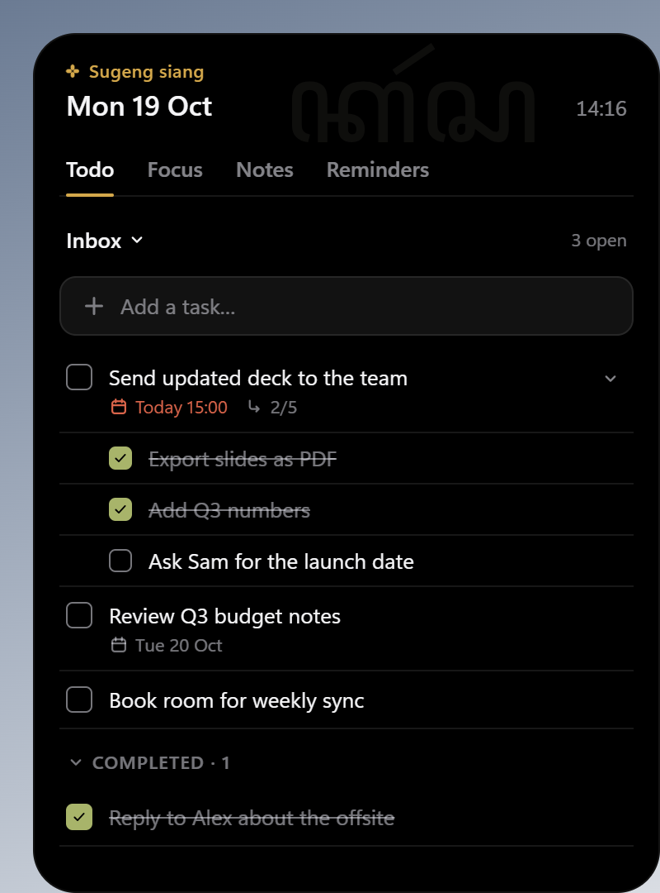

# Karsa

A lightweight "dynamic island" companion for Windows 11: a small black pill in the bottom-right corner, or a notch at the top of the screen, that grows into todos, a Pomodoro timer, notes, meeting notes and reminders, with quick capture from any app, a 24-hour clipboard history, a file shelf and media controls.



## Download

1. Go to [Releases](https://github.com/fazarashif/karsa/releases/latest) and download `Karsa_<version>_x64-setup.exe`.
2. Run it. It installs for your Windows account only, so it needs no administrator rights.
3. The installer is not code-signed, so Windows SmartScreen may say "Windows protected your PC". Click **More info**, then **Run anyway**.

Karsa needs Windows 11 (64-bit). It appears as a small pill above the taskbar on the right (or as a notch at the top centre: Settings → Position); hover it for a summary, click it to open the panel. Press **Win+Shift+K** in any app to jot down a task or a note. Right-click the tray icon for Settings, "Wrap up the day" and Quit. It starts with Windows; turn that off in Settings.

Everything stays on your PC: Karsa makes no network requests, unless you turn on Lyrics in Settings, which asks lrclib.net for the lyrics of what is playing (title, artist, album and length only). With Outlook meetings turned on, Karsa reads your calendar from classic Outlook on this PC while it is open; it only reads, and keeps the meetings in memory. Tasks, reminders, settings and the clipboard history are in `%APPDATA%\app.karsa.desktop` (copied text is encrypted with your Windows account and deleted after 24 hours; turn it off in Settings), and notes are plain Markdown files in `Documents\Karsa\Notes` (or the folder you choose in Settings).

To uninstall, use Windows Settings → Apps → Installed apps → Karsa. That removes the app, its shortcut and its Start with Windows entry. Your data stays unless you tick "Delete the application data" in the uninstaller; notes are never deleted.

## About this project

See [docs/requirements.md](docs/requirements.md) for the full v1 requirements and milestones. The visual design system is [design/DESIGN.md](design/DESIGN.md) (tokens in `design/tokens.css`, assets in `design/assets`, mockups in `design/screens`); it was made from the brief in [docs/claude-design-brief.md](docs/claude-design-brief.md).

## Status

**v0.2.0: v1 (M0–M5) plus M6, the personal companion and tools.**

- **Island (M0):** Idle, Peek, Expanded and Alert states, click-through, focus handling, fullscreen hiding, tray icon, autostart.
- **Design system v1:** black island with Javanese accents (kawung, aksara watermark, *mripat* eyes, Javanese greetings).
- **Todo (M1):** lists, tasks, subtasks and due dates, saved in SQLite. The next task due today shows in the pill and in Peek.
- **Focus (M2):** Pomodoro timer run by the core, with a live countdown in the pill and Peek, the Focus tab, and silent phase-end alerts.
- **Reminders (M3):** one-off and repeating reminders with lead time and snooze, linked todo deadlines, a missed-reminders summary, and the next reminder in the pill and Peek.
- **Notes (M4):** Markdown notes and structured meeting notes (when, topic, attendees, notes, action items) in a folder of `.md` files, with search, "Add to todo" for action items, conflict detection for edits made elsewhere, and an "Open full" window.
- **Settings and polish (M5):** a Settings tab (Start with Windows, hide during fullscreen, Pomodoro lengths, default reminder lead time, notes folder), a per-user installer, and a performance pass that cut a running countdown from 4.4% to 0.8% of one core.
- **Personal companion and tools (M6):** your name, today's pasaran and a Javanese proverb of the day; *mripat* that glance at the cursor and react (proud, sulking, sleepy); the focus "kain" (four weeks of focus woven from kawung marks) and streak; the Rampung end-of-day ritual; quick capture with Win+Shift+K; a 24-hour encrypted clipboard history; a file shelf you drop or paste files onto and drag them out of; media controls in Peek and the pill; and "every few minutes" reminders, such as drinking water every 30 minutes on weekdays from 07:00 to 17:00.
- **Now playing and calendar (M8, next release):** design v2: a shape for each function in a 560 × 640 window; Karsa's character with a blangkon and new expressions; Now playing with every app that has media (its icon, and the site for a browser), a seek bar, shuffle and repeat when the app has them, and the app's volume; opt-in timed lyrics from lrclib.net and lyric focus in the pill; and a calendar tab with deadlines, reminders, meetings and focus per day.
- **Outlook meetings (M9, next release):** meetings from classic Outlook on this PC (read only) in the calendar, Peek and the pill; "+ Note" starts a meeting note with the title, time and people filled in; and an alert a chosen time before each meeting (Settings → Outlook).
- **The notch (M7, next release):** Settings → Position puts Karsa at the top centre of the screen as a slim notch (80 × 26, the eyes when idle) that grows downwards into Peek, alerts and the panel, instead of the bottom-right corner.

Release build, measured: ~0% CPU and ~75 MB RAM while idle (including WebView2), 0.8% of one core while a focus countdown runs, 60 fps morphs, a 1.8 MB installer, and the pill visible 1–2.5 s after launch depending on CPU speed. Details in [docs/requirements.md](docs/requirements.md#2-performance-budget).

## Stack

- [Tauri 2](https://tauri.app) with a Rust core (`src-tauri/`)
- Svelte 5 + TypeScript UI (`src/`), built with Vite
- SQLite through `rusqlite` (bundled), stored in `%APPDATA%\app.karsa.desktop\karsa.db`
- Notes as plain Markdown files, in `Documents\Karsa\Notes` by default (Obsidian-compatible)
- Win32 APIs through `windows-sys`

## Development

Prerequisites: Node.js 20+, Rust (stable, MSVC toolchain), and the MSVC C++ build tools with the Windows SDK.

```powershell
npm install
npm run tauri dev
```

On a machine whose Visual Studio is missing the standard x64 C runtime libraries (see the comment in the script), load the build environment first, in the same PowerShell session:

```powershell
. .\scripts\msvc-env.ps1
npm run tauri dev
```

Other scripts:

| Command | What it does |
|---|---|
| `npm run dev` | UI only, in a browser at http://localhost:1420, with an in-memory stand-in for the todo storage. Use `karsa.alert()` and `karsa.fullscreen(true)` in the console to simulate core events. |
| `node scripts/import-design-assets.mjs` | Copies the SVGs the app uses from `design/assets` to `src/assets`, stripping the design tool's metadata. Run it after updating `design/`. |
| `npm run check` | Type-checks the Svelte/TypeScript code |
| `npm run tauri build` | Builds the release app and the installer, `src-tauri\target\release\bundle\nsis\Karsa_<version>_x64-setup.exe` (the first run downloads NSIS, ~2 MB). It installs per user into `%LOCALAPPDATA%\Karsa`. |
| `npm run tauri build -- --no-bundle` | Builds only `src-tauri/target/release/karsa.exe` |

Set `KARSA_DATA_DIR` to a folder to give a test or development instance its own database instead of `%APPDATA%\app.karsa.desktop`, and its own notes in `<folder>\Notes` (unless a notes folder is set in Settings). Set `KARSA_TEST_NO_FOCUS` (to any value) on an instance driven by tests: its panel then never takes keyboard focus, so it cannot pull focus from the app you are working in.

Start with Windows is switched on automatically on first run only for installed copies; builds run from `src-tauri/target/` never register themselves. Toggle it in Settings or the tray menu.

## Making a release

Installers are built by GitHub Actions on a Windows runner ([.github/workflows/release.yml](.github/workflows/release.yml)), so nothing needs to be built or uploaded locally. For version 0.1.1:

1. Bump the version in all three places:
   - `package.json`: run `npm version 0.1.1 --no-git-tag-version`, which also updates `package-lock.json`.
   - `src-tauri/Cargo.toml`: edit `version` under `[package]`, then run `cargo update --workspace --offline` in `src-tauri` to update `Cargo.lock`.
   - `src-tauri/tauri.conf.json`: edit `version`. The installer is named after it.
2. Update the installer name under [Download](#download) and the [Status](#status) section.
3. Commit, tag and push the tag:

   ```powershell
   git commit -am "Karsa 0.1.1"
   git tag v0.1.1
   git push origin main v0.1.1
   ```

4. The tag starts the **Release** workflow. It stops if the tag does not match all three versions; otherwise it builds `Karsa_0.1.1_x64-setup.exe` and attaches it to a draft release whose notes include the installer's SHA-256.
5. Open the draft on the [Releases](https://github.com/fazarashif/karsa/releases) page, replace the TODO with what changed, and publish it.

To test a build without releasing, open Actions → Release → **Run workflow**. The installer is attached to the run as an artifact for 14 days.

## How the island works

- The window never resizes: it is a fixed 560 × 640 transparent, always-on-top window (400 × 540 before M8) anchored to the bottom-right of the primary monitor's work area, or to the top centre for the notch. Only the web content animates, which keeps the morph smooth.
- Everything outside the visible box is click-through: the UI reports the box size and the core clips the window to it with a window region (`SetWindowRgn`). The region grows before a morph and shrinks once it settles.
- The window is `WS_EX_NOACTIVATE` in every state except Expanded, so hovering or clicking the island never steals keyboard focus from the app you are using.
- Fullscreen apps are detected from shell notifications and foreground-window changes (`src-tauri/src/hooks.rs`), not by polling; the island hides until they exit.
- Visibility, focus and click-through are set with Win32 calls in `src-tauri/src/island.rs`, never through Tauri's window setters, which re-apply every style and call `ShowWindow` (hiding the island or stealing focus).
- WebView2 runs with software compositing (`additionalBrowserArgs` in `tauri.conf.json`). For this small surface it is as smooth as GPU compositing, uses less CPU while animating, and saves ~70 MB of memory.

## License

Copyright © 2026 Faza Rashif. All rights reserved. You are welcome to download and use Karsa; the source code is published for reference and is not licensed for reuse.
